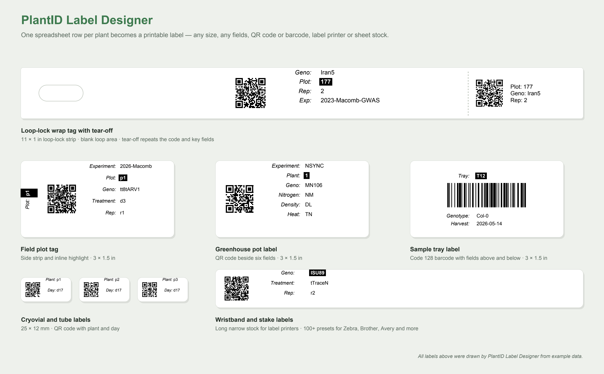

# PlantID Label Designer 

## Description
PlantID Label Designer is a Streamlit web application for generating customizable plant sample labels. The app allows researchers to visualize, design, and export labels with QR codes, highlighted metadata, and flexible sizing for a variety of use cases including cryovials, plant tags, wrap tags, and more.
It is designed to work both locally and on Streamlit Cloud.



## Try the online version
Try the app directly without installation
https://plantid-label-designer.streamlit.app


## Installation (Local)
Clone this repository
```bash
git clone https://github.com/danforthcenter/PlantID.git
cd PlantID/PlantID-LabelDesigner-streamlit
```
Install required packages
```bash
pip install -r requirements.txt
```

## Running the app
Run the app locally:
```bash
streamlit run streamlit_app.py
```
## Using the app

1. **Choose your data**: upload a CSV or Excel (`.xlsx`) file with one row per plant or sample, or try the example dataset. Values are printed exactly as written, so IDs such as `00123` keep their leading zeros.
2. **Choose a label design**: start from defaults, one of the examples, or a layout file you saved earlier.
3. **Design** the label in the sidebar while watching the live preview. The label border, spacing and offset adjustments, and wrap tags are under **Show advanced settings**. The app warns when text does not fit or a QR code or barcode is too small to scan reliably.
4. **Select rows** to print using row ranges, filters, and the Print checkboxes.
5. **Export**: choose a label printer or sheet stock and click **Download labels PDF**. For sheets, preview the first page and print the **alignment test page** on plain paper to check alignment against your stock first. Always print at 100% / actual size.

## Versioning

| Version | Current |
|---|---|
| App | 0.10 |
| Layout schema | 1 |

The **app version** reflects the overall release of PlantID Label Designer. The **layout schema version** tracks the structure of saved layout `.json` files and only increments when the format changes in a way older apps cannot read. Layouts saved with an older schema are converted automatically when loaded; save them again to update the file. The app warns if a layout uses a newer schema than it supports.

## Layout files

**Save Custom Layout** downloads the label design as JSON, which can be loaded on the start screen (Step 2) to reuse it with any dataset. A layout stores the design only — label size, fields, code, text, highlight, printer and wrap tag settings — not the data, row ranges, filters, or the first label position on a sheet. If the dataset is missing a column the layout refers to, the app lists it and uses a default instead.

```json
{
  "schema_version": 1,
  "app": "PlantID Label Designer",
  "app_version": "0.10",
  "layout": {
    "data": { "fields": ["Plant", "Geno"], "field_labels_enabled": false, "field_labels": {}, "split": { "enabled": false, ... } },
    "label": { "preset": "PR1MA 85 Tag", "width_mm": 33.0, "height_mm": 13.0, "display_units": "mm", "padding_mm": 2, "border": true },
    "code": { "type": "qr", "column": "PlantID", "position": "left", "edge_offset_mm": 2, "qr_size_mm": 10, ... },
    "text": { "font": "Helvetica", "font_size_pt": 6, "show_field_names": false, ... },
    "highlight": { "column": null, "color": "black", ... },
    "wrap_tag": { "enabled": false, ... },
    "printer": { "type": "sheet", "sheet_stock": "PR1MA 85 Tag Sheet (5 x 17)", "page_format": "letter",
                 "margins_mm": { "top": 6.0, "right": 19.39, "bottom": 4.4, "left": 19.51 },
                 "gaps_mm": { "horizontal": 3.0, "vertical": 3.0 } }
  }
}
```

Sizes are in millimetres. `label.preset` and `printer.sheet_stock` name a built-in preset, or are `null` for a custom size or spacing; the page size, margins and gaps are always saved so a sheet layout still prints if a preset is renamed. See [`example_layout.json`](PlantID-LabelDesigner-streamlit/example_layout.json) and [`example_sheet_layout.json`](PlantID-LabelDesigner-streamlit/example_sheet_layout.json) for complete files, and [`layout_schema.py`](PlantID-LabelDesigner-streamlit/layout_schema.py) for every field.
